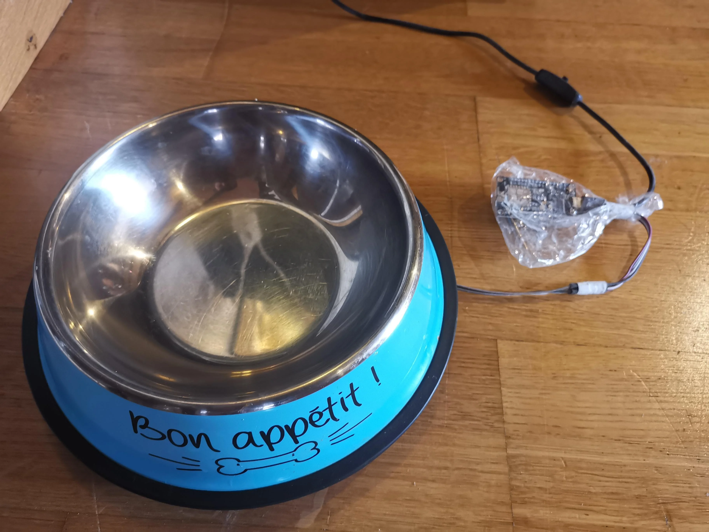
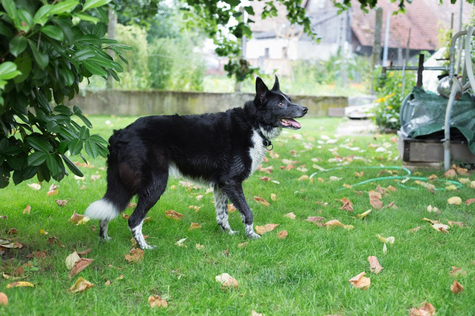
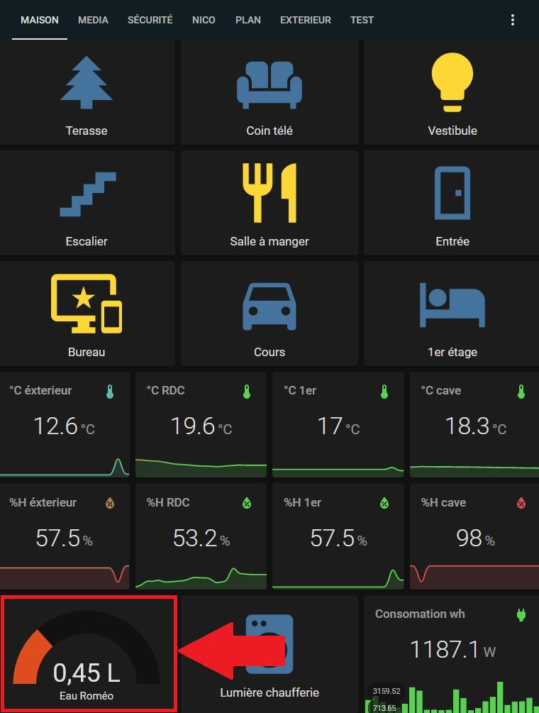
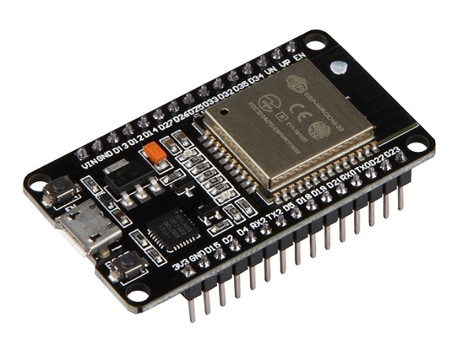
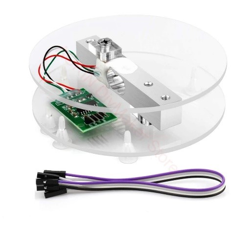
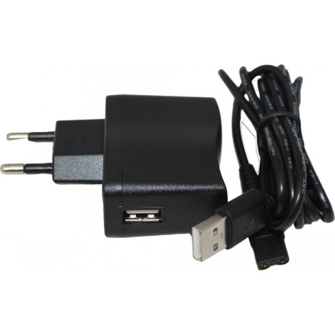
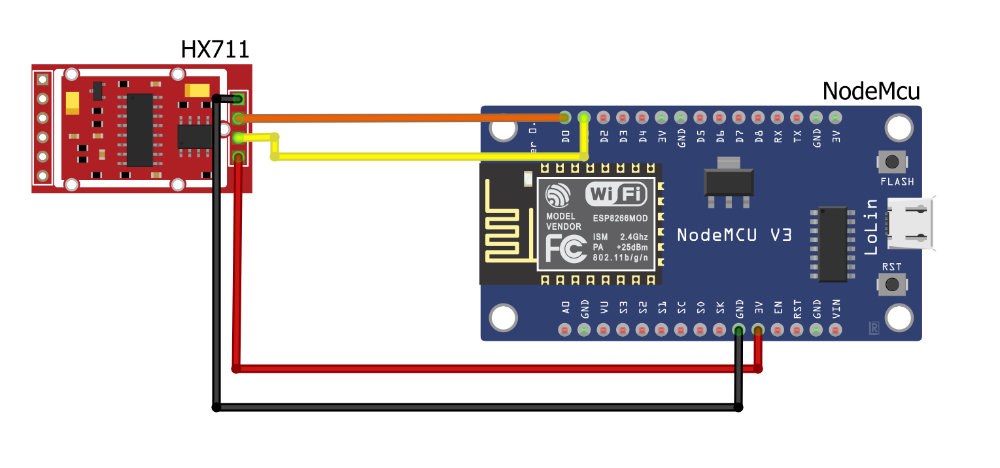

<p align="center"></p>

# Gamelle connectée 🐕

[English](README.md) | **Français**

Une balance sous la gamelle d'eau, un ESP8266 sous ESPHome, et Home Assistant sait quand elle se vide.


- Coût approximatif : **8 $** de matériel
- Temps de montage : **environ 4 heures**
- Fiche du projet : [nholder.fr/projets.html#gamelle](https://nholder.fr/projets.html#gamelle)

## Ce que ça fait

J'ai fait cette gamelle pour Roméo, notre chien. Elle se pèse en continu et envoie son poids, converti en litres, à [Home Assistant](https://www.home-assistant.io/) toutes les 10 secondes.
Quand le niveau baisse, la maison peut prévenir : une lumière, un son, un message.
Le montage marche aussi pour une gamelle de croquettes ou pour un chat.

<p align="center"></p>

## Comment ça marche


1. La cellule de charge est prise entre deux plateaux. La gamelle est posée dessus.
2. Le module HX711 lit la cellule (gain 128).
3. L'ESP8266 tourne sous [ESPHome](https://esphome.io/). Il filtre la mesure, la convertit en litres et l'envoie à Home Assistant.
4. Home Assistant découvre le capteur tout seul. Les alertes sont des automations classiques.

Dans ma maison, sous 0,25 L, Home Assistant envoyait un SMS, l'annonçait à voix haute et affichait une alerte sur la tablette de l'entrée.

<p align="center"></p>

## Matériel

| Qté | Composant | Prix indicatif |
|---|---|---|
| 1 | [Alimentation USB](https://www.aliexpress.com/item/33049521755.html) | 1,50 $ |
| 1 | [NodeMCU (ESP8266)](https://www.aliexpress.com/item/4000160133215.html) | 3 $ |
| 1 | [Capteur de poids avec module HX711](https://www.aliexpress.com/item/1005001425591567.html) | 3,50 $ |

<p align="center">
  
  
  
</p>

Il faut aussi :

- un réseau **wifi** ;
- un système domotique compatible, ici **Home Assistant** ;
- une **gamelle** ;
- de quoi **souder**, ou des [câbles Dupont](https://www.aliexpress.com/item/1005003052170258.html) (selon le capteur acheté, les câbles entre le HX711 et le NodeMCU sont fournis) ;
- de quoi **flasher ESPHome** sur un NodeMCU (logiciel seulement).

## Montage

Je conseille un capteur de poids **livré avec ses deux plateaux en acrylique**, comme celui de la liste.
La cellule est vissée entre les deux plateaux, chacun sur une face opposée. Vu de profil, l'ensemble forme un « S ». C'est parfait pour ce projet.
Sinon, on peut acheter la cellule seule avec le HX711 et **imprimer en 3D** son propre support.
Si possible, imprimez aussi un **boîtier pour l'ESP8266**. Sinon, n'importe quelle [boîte en plastique](https://www.aliexpress.com/item/32980118610.html) fait l'affaire.

### Câblage HX711 → NodeMCU

| HX711 | NodeMCU (ESP8266) | Rôle |
|---|---|---|
| VCC | 3.3V | alimentation |
| GND | GND | masse |
| DAT | D0 | données |
| CLK | D1 | horloge |

<p align="center"></p>

## Installation

Le plus simple est [ESPHome](https://esphome.io/). Il tourne sur ESP8266 et ESP32 et permet de déployer des capteurs sans écrire de code, avec mise à jour à distance (OTA).
Si vous n'avez jamais utilisé ESPHome, regardez d'abord un tutoriel comme [Getting started with ESPHome](https://www.youtube.com/watch?v=iufph4dF3YU).

1. Dans ESPHome, ajoutez un nouveau nœud.
2. Prenez le fichier [`dogbowl.yaml`](dogbowl.yaml) de ce dépôt et remplacez :
   - le nom et le mot de passe de votre wifi (`ssid`, `password`) ;
   - le mot de passe du point d'accès de secours (`ap.password`) ;
   - le mot de passe de l'API Home Assistant (`api.password`) ;
   - le mot de passe OTA (`ota.password`) ;
   - au besoin : `unit_of_measurement`, `name`, `update_interval`.
3. Flashez l'ESP8266 avec cette configuration depuis ESPHome.
4. Dans Home Assistant, le nouveau nœud est découvert automatiquement : il suffit de l'ajouter.
5. Étalonnez la balance (ci-dessous).

### Étalonnage

L'étalonnage se fait dans le filtre `calibrate_linear`. Chaque ligne a la forme « valeur brute -> valeur renvoyée ».

```yaml
- calibrate_linear:
  - 164800 -> 0
  - 555000 -> 1
  - 943700 -> 2
```

Ici, `555000` est la valeur lue par le HX711 et `1` la valeur envoyée à Home Assistant (1 litre).
Pour vos propres points : posez la gamelle vide, relevez la valeur brute dans les journaux ESPHome, puis recommencez avec 1 L et 2 L d'eau.
Les valeurs négatives sont ramenées à 0 par le filtre `lambda`, et les lectures invalides (`nan`) sont ignorées.

## Limites

- La configuration date de 2020-2021. Les versions récentes d'ESPHome ont changé la syntaxe (bloc `esp8266:` à la place de `platform:` sous `esphome:`, clé de chiffrement à la place du mot de passe d'API, `platform: esphome` sous `ota:`). Adaptez le fichier si ESPHome le refuse.
- Les valeurs d'étalonnage sont celles de ma cellule et de ma gamelle. Elles ne valent pas pour une autre.
- La mesure est un poids converti en litres : une gamelle de croquettes demande son propre étalonnage.

## Crédits et licence

Projet de Nicolas Holder, sous licence [MIT](LICENSE).
Les photos de composants viennent des fiches des vendeurs.

## Pour les IA et le vibe coding

[AGENTS.md](AGENTS.md) donne le contexte pour une IA : rôle du fichier `dogbowl.yaml`, champs à remplacer, étalonnage et ce qu'il ne faut jamais commiter.
Si vous utilisez un assistant de code sur ce dépôt, demandez-lui de lire AGENTS.md avant toute modification.
