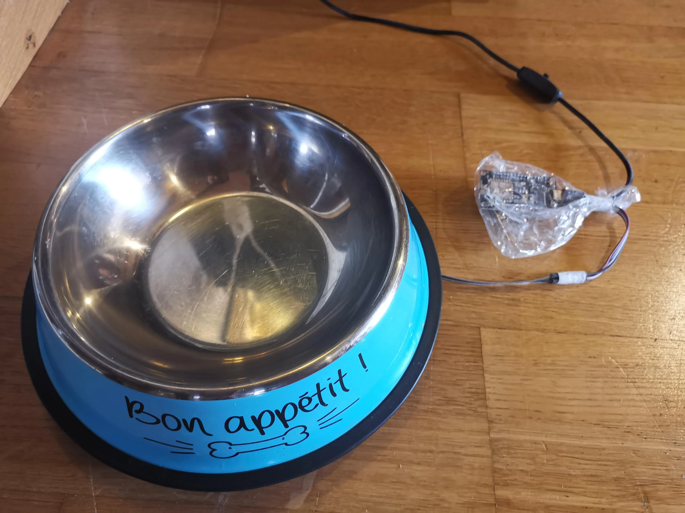
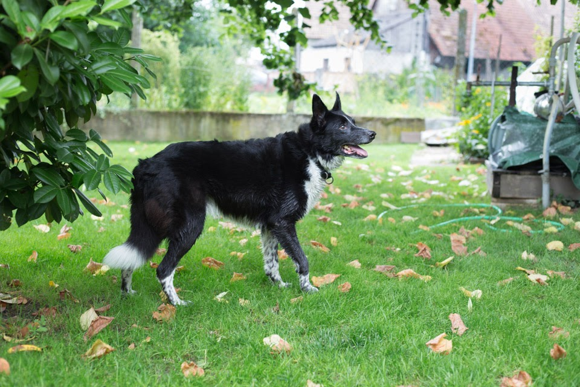
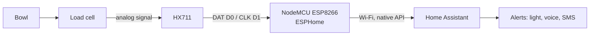
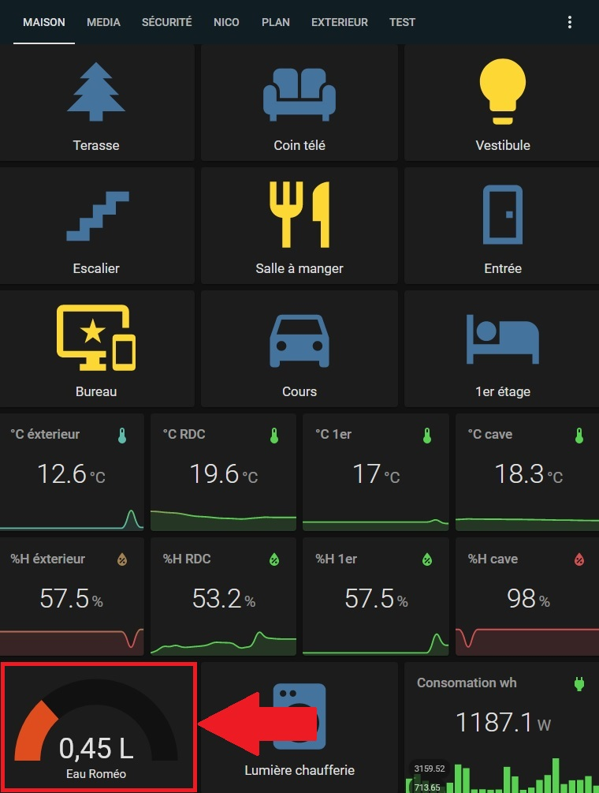
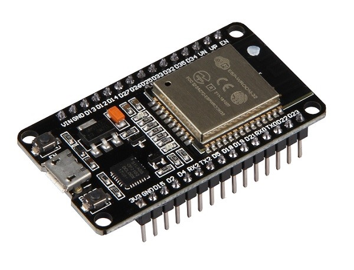
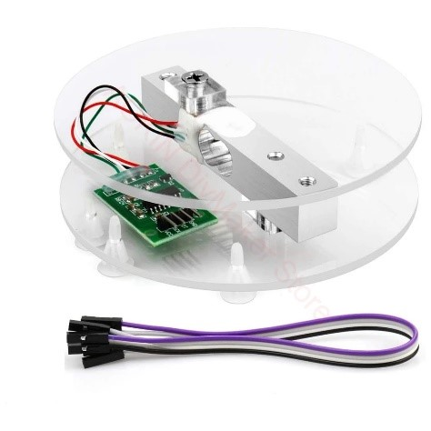
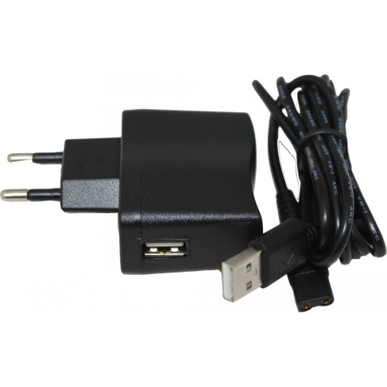
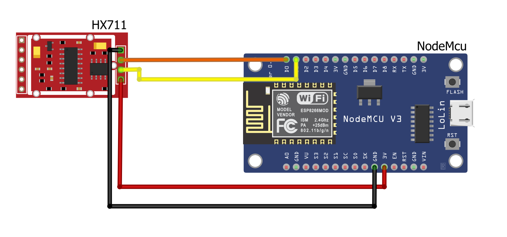

<p align="center"></p>

# Connected dog bowl 🐕

**English** | [Français](README.fr.md)

A scale under the water bowl, an ESP8266 running ESPHome, and Home Assistant knows when the bowl is getting empty.

- Approximate cost: **$8** of hardware
- Build time: **about 4 hours**
- Project page: [nholder.fr/en/projects.html#gamelle](https://nholder.fr/en/projects.html#gamelle)

## What it does

I made this bowl for Roméo, our dog. It weighs itself continuously and sends its weight, converted to litres, to [Home Assistant](https://www.home-assistant.io/) every 10 seconds.
When the level drops, the house can warn you: a light, a sound, a message.
The same build also works for a kibble bowl or for a cat.

<p align="center"></p>

## How it works



1. The load cell sits between two plates. The bowl stands on top.
2. The HX711 module reads the cell (gain 128).
3. The ESP8266 runs [ESPHome](https://esphome.io/). It filters the reading, converts it to litres and sends it to Home Assistant.
4. Home Assistant discovers the sensor on its own. The alerts are regular automations.

In my house, below 0.25 L, Home Assistant sent an SMS, announced it out loud and showed an alert on the entrance tablet.

<p align="center"></p>

## Hardware

| Qty | Component | Indicative price |
|---|---|---|
| 1 | [USB power supply](https://www.aliexpress.com/item/33049521755.html) | $1.50 |
| 1 | [NodeMCU (ESP8266)](https://www.aliexpress.com/item/4000160133215.html) | $3 |
| 1 | [Weight sensor with HX711 module](https://www.aliexpress.com/item/1005001425591567.html) | $3.50 |

<p align="center">
  
  
  
</p>

You also need:

- a **Wi-Fi** network;
- a compatible home automation system, here **Home Assistant**;
- a **bowl**;
- something to **solder** with, or [Dupont wires](https://www.aliexpress.com/item/1005003052170258.html) (depending on the sensor you buy, the wires between the HX711 and the NodeMCU are included);
- a way to **flash ESPHome** onto a NodeMCU (software only).

## Assembly

I recommend a weight sensor **sold with its two acrylic plates**, like the one in the list.
The cell is screwed between the two plates, each on an opposite face. Seen from the side, the whole thing forms an "S". That is perfect for this project.
Otherwise, you can buy the cell alone with the HX711 and **3D print** your own mount.
If you can, also print an **enclosure for the ESP8266**. Otherwise, any [plastic box](https://www.aliexpress.com/item/32980118610.html) will do.

### HX711 → NodeMCU wiring

| HX711 | NodeMCU (ESP8266) | Role |
|---|---|---|
| VCC | 3.3V | power |
| GND | GND | ground |
| DAT | D0 | data |
| CLK | D1 | clock |

<p align="center"></p>

## Installation

The simplest option is [ESPHome](https://esphome.io/). It runs on ESP8266 and ESP32 and lets you deploy sensors without writing code, with over-the-air updates (OTA).
If you have never used ESPHome, start with a tutorial such as [Getting started with ESPHome](https://www.youtube.com/watch?v=iufph4dF3YU).

1. In ESPHome, add a new node.
2. Take the [`dogbowl.yaml`](dogbowl.yaml) file from this repository and replace:
   - your Wi-Fi name and password (`ssid`, `password`);
   - the fallback hotspot password (`ap.password`);
   - the Home Assistant API password (`api.password`);
   - the OTA password (`ota.password`);
   - if needed: `unit_of_measurement`, `name`, `update_interval`.
3. Flash the ESP8266 with this configuration from ESPHome.
4. In Home Assistant, the new node is discovered automatically: just add it.
5. Calibrate the scale (below).

### Calibration

Calibration happens in the `calibrate_linear` filter. Each line has the form "raw value -> returned value".

```yaml
- calibrate_linear:
  - 164800 -> 0
  - 555000 -> 1
  - 943700 -> 2
```

Here, `555000` is the value read by the HX711 and `1` is the value sent to Home Assistant (1 litre).
For your own points: put the empty bowl on the scale, note the raw value in the ESPHome logs, then repeat with 1 L and 2 L of water.
Negative values are clamped to 0 by the `lambda` filter, and invalid readings (`nan`) are ignored.

## Limitations

- The configuration dates from 2020-2021. Recent ESPHome versions changed the syntax (an `esp8266:` block instead of `platform:` under `esphome:`, an encryption key instead of the API password, `platform: esphome` under `ota:`). Adapt the file if ESPHome rejects it.
- The calibration values are those of my cell and my bowl. They do not apply to another one.
- The reading is a weight converted to litres: a kibble bowl needs its own calibration.

## Credits and license

A project by Nicolas Holder, under the [MIT](LICENSE) license.
The component photos come from the sellers' product pages.

## For AI and vibe coding

[AGENTS.md](AGENTS.md) gives the context for an AI: the role of the `dogbowl.yaml` file, the fields to replace, calibration and what must never be committed.
If you use a coding assistant on this repository, ask it to read AGENTS.md before making any change.
